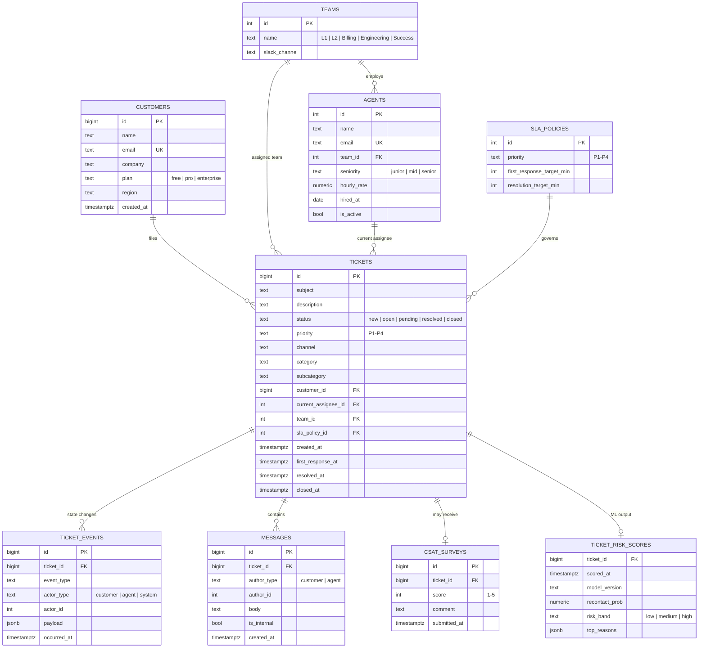

# Ticketing Management System — Project Blueprint (v1)

**Status:** Phase 0 (design) complete → next: Phase 1 (foundations)
**Date:** 2026-10-05
**Repo (working name):** `ticketing-system` — brand the UI later
**Companion file:** `docs/architecture.html` (visual diagram)

---

## 0. How we work

- **One step at a time.** Each step is small enough to run and verify in one sitting.
- Hermes gives exact code + commands; **you** paste, run, and report back the output (or the full error).
- Every phase ends with a **Definition of Done (DoD)** checklist and a git commit.
- If something breaks: paste the whole error. No pushing through silently.

---

## 1. The project

A **fake but internally consistent customer-support operation**, built as a portfolio project: agents resolve tickets in a web console backed by a real REST API, PostgreSQL, and Redis — and the platform's own data feeds a serious analytics + ML layer on top of it.

Two stories in one repo:

| Track | What it proves |
|---|---|
| Full-stack engineering | Postgres + Redis + FastAPI + React, auth, caching, tests, CI |
| Data / Analytics / ML | SQL modeling, Power BI dashboards, data-quality validation, binary classification with a business decision layer |

### Scope

**In (v1):**
- Ticket lifecycle: create → assign → transfer → escalate → resolve → reopen/close
- 25,000+ synthetic tickets over 21 months with **event-level histories**
- REST API (FastAPI) + agent web console (React)
- SQL analytics layer + Power BI dashboards: resolution time, transfers, escalations, support costs, data quality
- ML model: P(customer contacts again within 7 days) at resolution → risk flags
- Tests, data-quality checks, CI, docs, README

**Out (stretch/later):**
- Native mobile app (v1 is responsive web only)
- Production deployment (stretch, Phase 7)
- Real email/phone integrations (channels are simulated)
- Payments, multi-tenancy

---

## 2. Architecture

```
                    ┌───────────────────────────────┐
   CLIENTS          │  React SPA (Vite + JS)        │
                    │  Agent console · Dashboards   │
                    └──────────────┬────────────────┘
                                   │ REST / JSON (JWT)
                    ┌──────────────▼────────────────┐
   API              │  FastAPI  (/api/v1)           │
                    │  auth · tickets · lifecycle   │
                    │  metrics · directory · /docs  │
                    └───────┬───────────────┬───────┘
                            │               │
                    ┌───────▼──────┐  ┌─────▼──────────┐
   DATA             │ PostgreSQL 16│  │ Redis 7        │
                    │ source of    │  │ cache · rate   │
                    │ truth (OLTP) │  │ limit · tokens │
                    │ + SQL views  │  └────────────────┘
                    └──┬────────┬──┘
                       │        │
        ┌──────────────▼──┐  ┌──▼─────────────────────┐
        │ Power BI        │  │ Python ML pipeline     │
        │ dashboards      │  │ EDA → train → score    │
        │ (via SQL views) │  │ writes risk scores ────┼──► back into PG
        └─────────────────┘  └────────────────────────┘
```

### The three design decisions everything hangs on

1. **Events are the source of truth.** Every state change writes a row to `ticket_events`. Current-state columns on `tickets` are derived from the event stream and *verified against it*. This one choice is what makes resolution-time, transfer, escalation, and cost metrics accurate — and what makes leak-free ML features possible later.
2. **Metrics are defined once, in SQL.** The BI dashboards, the API's `/metrics` endpoints, and the ML feature queries all read the same analytics views. No drift between "the dashboard number" and "the API number".
3. **The fake data is engineered, not random.** A seeded, deterministic generator simulates ~27k ticket lifecycles with realistic mess (SLA breaches, transfers, escalations, seasonality) and embeds a *learnable but noisy* recontact signal — strong enough that the model works (target AUC ≈ 0.78–0.86), weak enough to be honest. If your model hits 0.99, the data generator is cheating.

---

## 3. Stack decisions

| Layer | Choice | Why this one |
|---|---|---|
| API framework | **FastAPI** | "framework meh" resolved: async, Pydantic validation, auto OpenAPI docs at `/docs`. Best default for modern Python APIs. |
| ORM / migrations | **SQLAlchemy 2.0 + Alembic** | The standard; Alembic gives versioned schema history. |
| Database | **PostgreSQL 16** (Docker) | As planned. Also hosts the analytics views. |
| Cache / ephemeral | **Redis 7** (Docker) | As planned: cache, rate limiting, refresh tokens. |
| Frontend | **React 18 + Vite + JavaScript** | As planned. + React Router, TanStack Query, Axios |
| UI kit | **MUI** | DataGrid + timeline components out of the box → fast path to a credible support console. |
| Tests / CI | **pytest + httpx**, ruff, GitHub Actions | Portfolio must-have. |
| Analytics | **SQL views → Power BI** | See macOS note below. |
| ML | **pandas + scikit-learn + LightGBM + SHAP** | Solid, well-documented, resume-standard. Jupyter for EDA only; scripts for the real pipeline. |
| Infra | **Docker Compose** (postgres + redis + adminer) | One command reproducible env. API/web run locally for fast dev loops. |

> ⚠️ **Power BI on macOS:** Power BI *Desktop* is Windows-only, and no Windows VM is installed on this Mac. Two viable paths (decide at Phase 5):
> 1. **Power BI Service (browser) + a small Python job that pushes aggregate tables via the REST API** — fully Mac-native, no gateway needed. Reports live in the Service.
> 2. **Windows VM (UTM/Parallels) + Power BI Desktop** → produces real `.pbix` files. Most "resume-real" artifact; needs a Windows license/VM.
>
> We keep the metric layer tool-agnostic either way, so this decision doesn't block anything until Phase 5.

### Local environment status (checked 2026-10-05)

| Tool | Status |
|---|---|
| Python | ✅ 3.13.5 (Anaconda) — we'll still create a project venv, not install into conda base |
| Node / npm | ✅ v26.7.0 / 11.19 |
| git | ⚠️ 2.15 (2017!) — `brew install git` in Phase 1 |
| Docker | ❌ not installed — `brew install --cask docker` in Phase 1 (or fallback: Homebrew Postgres+Redis) |
| Homebrew | ✅ 5.1.15 |

---

## 4. Data model (v1)



**`ticket_events.event_type` enum:**
`created · assigned · transferred · escalated · deescalated · priority_changed · status_changed · sla_breach · agent_reply · customer_reply · internal_note · resolved · reopened · closed · csat_requested · csat_submitted`

**Conventions:** timestamptz in UTC everywhere · `snake_case` · plural table names · `bigserial` PKs · JSONB `payload` on events (from/to values, reasons, handling minutes) · indexes on `(ticket_id, occurred_at)`, `(status, priority)`, `(created_at)`.

**Note:** `tickets` also carries denormalized counters (`transfer_count`, `reopen_count`, `max_escalation_level`) recomputed by the seed and maintainable by the API — cheap reads, still derived from events.

---

## 5. Synthetic data strategy

**The generator is a first-class deliverable** ("data provenance"): reproducible, seeded, and documented.

| Property | Target |
|---|---|
| Window | 2025-01-01 → 2026-09-30 (~21 months) |
| Tickets | ~27,000 |
| Customers | ~7,000 (repeat behavior is power-law) |
| Agents / teams | 45 / 5 |
| Channels | email 45% · chat 30% · phone 10% · web form 10% · API/partner 5% |
| Categories | bug 25% · billing 20% · how-to 15% · account/auth 15% · feature-request 10% · integrations 10% · other 5% |
| Priorities | P1 5% · P2 20% · P3 55% · P4 20% |
| Recontact ≤7d | 18–22% |
| Reopen rate | 6–8% |
| ≥1 transfer | ~25% |
| Escalation rate | ~9% |
| SLA breach | ~12% |
| CSAT | ~35% response rate, mean 4.1/5 |

**Generation order:** customers → agents/teams → per-ticket lifecycle simulation:
1. Arrival time (Poisson-ish with business-hour curve, weekend dip, a couple of "incident spike" days)
2. Routing + handling segments (durations log-normal, shorter for easy categories)
3. Transfers / escalations driven by complexity features
4. Resolution + CSAT + reopen behavior
5. **Recontact ≤7d** as a Bernoulli draw with logit driven by design features (category, escalation, prior recontacts, resolution time, CSAT, transfer count, plan) + noise — coefficients tuned so the outcome rate and achievable model performance land in the target bands

**Integrity by construction:** events are generated first; every ticket column is *computed from its events*. A separate QC script re-verifies them independently.

**Right-censoring:** tickets resolved in the last 7 days of the window can't observe the full outcome → flagged `label_censored`, excluded from ML training/eval.

**Determinism:** fixed seed (e.g. `SEED=42`) → byte-identical dataset on every run.

**Data-quality checks (~10, the "validation" deliverable):**
1. No orphan foreign keys anywhere
2. Timestamp ordering sane (`resolved ≥ first_response ≥ created`; events monotonic per ticket)
3. `tickets.status` consistent with the ticket's last lifecycle event
4. Exactly one resolution event per resolved ticket
5. SLA breach flag consistent with policy targets + timestamps
6. No duplicate keys / customer emails
7. Recontact label computable for all uncensored tickets
8. Row counts ≥ 25,000 tickets, all dims populated
9. Positive rate within 18–22%
10. Counter columns (`transfer_count`, etc.) match event counts

Output as `analytics.v_data_quality` → doubles as a Power BI page.

---

## 6. REST API (v1 spec)

**Conventions:** base `/api/v1` · `Authorization: Bearer <access>` (access 30 min, refresh 14 d, rotated + revocable via Redis) · offset pagination `?page&page_size` (cap 100) with `{items, total, page, page_size}` envelope · filters as query params · `{error: {code, message, details}}` envelope · Swagger at `/docs`.

| Group | Endpoints |
|---|---|
| Auth | `POST /auth/login` · `POST /auth/refresh` · `GET /auth/me` |
| Tickets | `GET /tickets` (status, priority, team, assignee, category, channel, date range, `q`) · `POST /tickets` · `GET /tickets/{id}` (incl. timeline) · `PATCH /tickets/{id}` |
| Lifecycle | `POST /tickets/{id}/assign` · `/transfer` · `/escalate` · `/resolve` · `/reopen` · `/close` — each writes event(s), returns updated ticket; invalid transitions → 409 (small state machine enforced in `services/`) |
| Conversation | `POST /tickets/{id}/messages` · `GET /tickets/{id}/messages` (incl. internal notes) |
| Directory | `GET /agents` · `GET /teams` · `GET /customers` · `GET /customers/{id}/tickets` |
| Metrics | `GET /metrics/overview` · `/metrics/volume` · `/metrics/sla` · `/metrics/transfers` · `/metrics/escalations` · `/metrics/costs` — Redis-cached 60–300 s |
| ML (Phase 6) | `GET /risk/high-risk` (flagged tickets) · `POST /risk/score/{ticket_id}` (stretch) |
| Ops | `GET /health` · `GET /ready` · `GET /docs` |

**Redis usage:**
- `cache:metrics:{name}:{params_hash}` — TTL 60–300 s, busted on lifecycle writes (version-suffix scheme)
- `rl:{ip}:{bucket}` — rate limit: 120 req/min general, 10/min on `/auth/*`
- `auth:refresh:{jti}` — refresh token store (rotation, revocation)
- stretch: `queue:urgent` sorted set (unresolved P1/P2 by age) powering an "urgent" view

---

## 7. Frontend plan

| Page | Contents |
|---|---|
| `/login` | JWT login (agents) |
| `/queue` | MUI DataGrid: server-side filters (status, priority, team, assignee, category, date), search, pagination |
| `/tickets/:id` | Header (status, priority, assignee, team, SLA countdown) · conversation thread (public + internal notes) · event timeline sidebar · action bar: assign / transfer / escalate / reply / resolve / reopen |
| `/dashboard` | KPI cards (open, FRT p50, median TTR, SLA %, escalation rate, CSAT) + Recharts: volume trend, backlog, by-category breakdown — reads `/metrics/*` |
| stretch | `/portal` (customer submit + status), `/admin` (agents/teams/SLA policies) |

Stack: React Router (routing) · TanStack Query (server state) · Axios instance with refresh interceptor · MUI. App scaffold: Vite.

**DoD:** full lifecycle demoable from the UI: create → assign → transfer → escalate → resolve → see metrics update on dashboard.

---

## 8. Analytics plan (SQL + Power BI)

### Metric definitions (the contract — used by API, BI, and ML)

| Metric | Definition |
|---|---|
| FRT | `first agent reply − created` (p50/p90, by priority) |
| Resolution time (TTR) | `resolved − created` (median + p90; weekly trend; by category/priority) |
| Transfer rate | tickets with ≥1 `transferred` event ÷ all resolved tickets; avg per ticket; team→team path matrix |
| Escalation rate / depth | tickets with ≥1 `escalated` ÷ all; max level reached; ΔTTR escalated vs not, by category |
| Reopen rate | `reopened` events ÷ resolved |
| SLA compliance | vs `sla_policies` per priority (FRT + resolution targets); breach rate trend |
| Cost per ticket | Σ(handling minutes ÷ 60 × agent `hourly_rate`) × 1.30 overhead + escalation surcharge (engineering time at eng rate) — by category/channel/team |
| Recontact ≤7d | share of tickets whose customer contacts again within 7 days of resolution |
| Backlog aging | open tickets in age buckets (0–1d, 1–3d, 3–7d, 7d+) |

### SQL layer (`analytics/`)

- `v_ticket_facts` — one wide row per ticket: dims + timestamps + FRT/TTR + transfer/escalation/reopen counts + SLA flags + cost fields + recontact label + censoring flag. **The single source for BI and ML.**
- `v_daily_ops` — created/resolved/backlog by day, SLA %
- `v_transfer_paths` — from_team → to_team counts
- `v_escalation_trends` — week × category
- `v_cost_breakdown` — cost by category/team/channel/month
- `v_data_quality` — check name, expected, actual, pass/fail

### Power BI dashboards

1. **Ops Overview** — volume, backlog, FRT/TTR, SLA compliance
2. **Transfers & Escalations** — rates, path heatmap, TTR impact
3. **Support Costs** — cost per ticket/contact, by category & team, escalation premium
4. **Data Quality** — the validation page (this is a differentiator on a portfolio)

Plus `analytics/insights/insights.md` — written findings, each cited with the query that produced it.

---

## 9. ML plan — "Will this customer contact again within 7 days?"

**Label:** any customer-initiated contact (new ticket, reply, or reopen) within 7 days after the resolution timestamp.

**Prediction point:** at resolution → all features must be measurable ≤ `resolved_at`. (V2 idea: an at-creation triage model — later, not now.)

**Features (~25):**

| Group | Examples |
|---|---|
| Ticket | priority, channel, category, subcategory, created hour/weekday, subject/description length |
| Customer | plan, tenure days, tickets last 90d, recontacts last 180d (computed **as-of the ticket's created_at**), avg prior CSAT |
| Handling | FRT, TTR, handle minutes, transfer_count, escalated/max level, reopen_count_before, message counts, last message from whom, agent tenure + agent avg CSAT |
| Resolution | resolution category (if corrected), csat_requested (request ≠ score) |

**Leakage guards (checklist):** no features after `resolved_at` · exclude CSAT *score* (arrives after prediction point) · no random split (time-based: train ≤ 2026-02 / val 2026-03→06 / test 2026-07→09) · customer-history aggregates computed with window functions bounded by each ticket's own timeline (no full-data aggregates) · no raw ticket/agent IDs as features.

**Models:** Dummy → LogisticRegression (interpretable baseline) → **LightGBM** (main); optional XGBoost comparison.

**Metrics:** PR-AUC (primary — class imbalance) · ROC-AUC · recall@top-10% flagged · precision/recall at chosen threshold · calibration (reliability curve + Brier). Honest target: **AUC 0.78–0.86**.

**Decision layer (ties into cost analysis):** cost-sensitive threshold — FN = missed recontact (≈ avg recontact cost ~$28) vs FP = proactive outreach (~$8) → expected-cost curve picks the threshold → report "catches X% of recontacts, flags Y% of tickets, est. net savings $Z/month on holdout". (Associational demo — state the assumption that proactive outreach works.)

**Explainability:** SHAP global summary + top drivers → "actionable insights" bullets in the model card.

**Outputs:** `ticket_risk_scores` table (prob, band, `top_reasons` jsonb, model_version) · `/risk/high-risk` endpoint · `ml/artifacts/MODEL_CARD.md`.

---

## 10. Repo layout

```
ticketing-system/
├── backend/
│   ├── app/
│   │   ├── main.py
│   │   ├── core/            # config, security, dependencies
│   │   ├── api/             # routers: auth, tickets, lifecycle, messages, metrics, directory
│   │   ├── models/          # SQLAlchemy models
│   │   ├── schemas/         # Pydantic schemas
│   │   ├── services/        # lifecycle state machine, cost calc, caching
│   │   └── db/              # session, redis client
│   ├── alembic/             # migrations
│   ├── scripts/             # seed.py, qc_check.py
│   ├── tests/
│   ├── pyproject.toml
│   └── .env.example
├── frontend/                # Vite + React (JS)
│   └── src/{api,components,pages,hooks}
├── analytics/
│   ├── sql/                 # 01_views.sql … 90_quality_checks.sql
│   ├── powerbi/             # theme.json, connection notes, screenshots
│   └── insights/insights.md
├── ml/
│   ├── eda/                 # notebooks (exploration only)
│   ├── src/                 # features.py, train.py, evaluate.py, score.py
│   ├── artifacts/           # model, metrics.json, plots, MODEL_CARD.md
│   └── README.md
├── docs/
│   ├── design.md            # ← this file
│   └── architecture.html    # ← the diagram
├── docker-compose.yml       # postgres + redis + adminer
├── Makefile                 # make up / seed / api / web / qc
└── README.md
```

---

## 11. Roadmap

| Phase | What you build | Done when (DoD) | ~Evenings |
|---|---|---|---|
| **1. Foundations** | Repo + folder scaffold, git, docker-compose (PG + Redis), venv, FastAPI hello (`/health` + `/docs`), Vite hello app, Makefile, README | `docker compose up` works · API answers `/health` · web serves a page · first commit | 1–2 |
| **2. Data core** | SQLAlchemy models, Alembic initial migration, seed generator (~27k tickets + events + dims), QC checks | `make seed` populates · all ~10 QC checks pass · ERD committed | 2–3 |
| **3. REST API** | Full endpoints (§6), auth + JWT, lifecycle state machine, Redis caching + rate limiting, pytest suite | Swagger usable end-to-end · tests green · cache hit/miss demonstrable | 3–4 |
| **4. Frontend** | Login → queue → ticket workspace → actions → dashboard | Full lifecycle demoable from UI · dashboard shows live metrics | 4–5 |
| **5. Analytics** | SQL views, QC view, Power BI dashboards (4), insights doc | Dashboards built + documented metric definitions · insights cited | 3–4 |
| **6. ML** | EDA → feature builder → baseline → LightGBM → evaluation → scoring job → model card | Holdout PR-AUC/AUC in target band · risk scores in DB · SHAP insights written | 3–4 |
| **7. Polish** | README, CI, demo GIF, docs, (optional) deploy | Fresh clone → `make up && make seed` → everything works | 1–2 |

Total ≈ 17–23 evenings. Each phase gets detailed step-by-step instructions when we start it.

---

## 12. Open decisions

| # | Decision | When | My recommendation |
|---|---|---|---|
| 1 | Power BI path (Service+push vs Windows VM+Desktop) | Phase 5 | Service + Python push job first; VM later if you want `.pbix` files |
| 2 | Docker install (`brew install --cask docker`) vs Homebrew-native PG+Redis | Phase 1 | Docker — the compose file makes the repo reproducible |
| 3 | `brew install git` (2.15 is from 2017) | Phase 1 | Yes — some commands I'll give assume modern git (e.g. `git switch`, `init -b main`) |
| 4 | Public GitHub repo from the start? | Phase 1 | Yes, public + clean README early — it's a portfolio piece |
| 5 | TypeScript upgrade for frontend | later | Stick with JS per your plan; upgrade is a mechanical refactor if you ever want it |
| 6 | React Native mobile app | later | Responsive web in v1; RN only if the core is done and polished |
